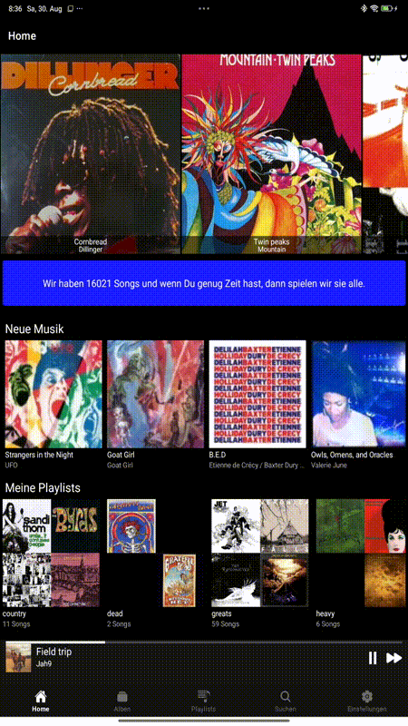
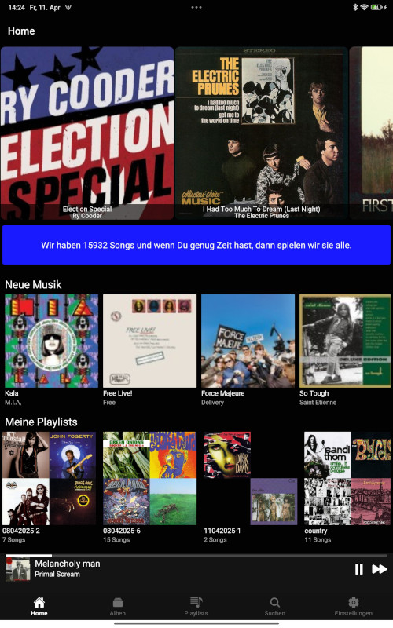
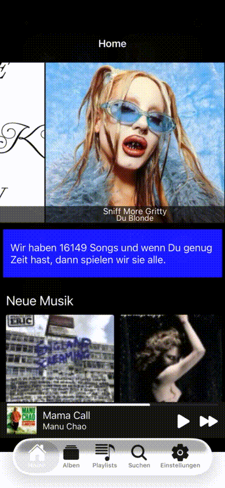
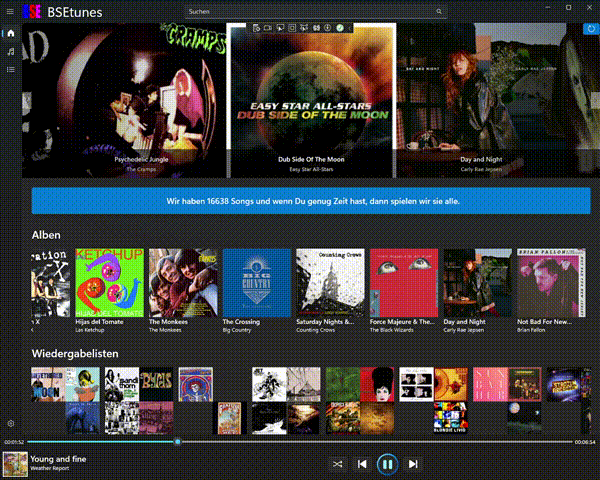

# BSEtunes Client

This repository contains the modern BSEtunes client applications and shared client-side infrastructure for the BSE system (our private "neighborhood Spotify").

You can play single tracks, full albums, playlists, and randomized music from your configured BSEtunes server.

## Clients

### .NET MAUI client
Cross-platform client for Android, iOS, and Windows.

### WinUI client
Native Windows desktop client (`BSE.Tunes.WinUI.Client`) based on WinUI and Windows App SDK.

## Solution structure

The solution `BSE.Tunes.Client.sln` currently contains these projects:

| Project | Type | Purpose |
|---|---|---|
| `Src/BSE.Tunes.Maui.Client` | App (.NET MAUI) | Cross-platform BSEtunes client UI and platform-specific startup/integration |
| `Src/BSE.Tunes.WinUI.Client` | App (WinUI 3) | Native Windows desktop BSEtunes client |
| `Src/BSE.Tunes.Shared.Services` | Class library | Shared services, models, media abstractions, data/authentication flow, extensions |
| `Src/BSE.Tunes.MediaExtensions` | Class library (.NET MAUI) | MediaElement-related cross-platform media support used by MAUI |
| `../BSE.Maui/src/BSE.Maui.Controls` | External project reference | Reused MAUI controls |
| `../../ASP.Net/BSEtunes/src/BSEtunes.Contracts` | External project reference | Shared DTO/contracts used by backend and clients |

## Architecture notes

- Features and reusable logic have been extracted into `BSE.Tunes.Shared.Services`.
- Both app clients consume shared contracts and shared services.
- Platform-specific concerns (app startup, settings persistence, media implementation, UI controls) stay in each app project.

## Requirements

- Visual Studio 2026 (or compatible) with:
  - .NET MAUI workload (for `BSE.Tunes.Maui.Client`)
  - Windows App SDK / WinUI tooling (for `BSE.Tunes.WinUI.Client`)
- .NET SDKs required by the projects (`net8.0`, `net9.0`, `net10.0-windows`)
- Local availability of the referenced sibling repositories/paths:
  - `../BSE.Maui/...`
  - `../../ASP.Net/BSEtunes/...`

## Build and run

1. Open `BSE.Tunes.Client.sln` in Visual Studio.
2. Restore NuGet packages.
3. Select startup project:
   - `BSE.Tunes.Maui.Client` for Android/iOS/Windows MAUI
   - `BSE.Tunes.WinUI.Client` for Windows desktop
4. Run with `Debug` configuration.

## Authentication and access

For legal and operational reasons (copyright, server load, bandwidth), anonymous access is not supported.

- Login is required.
- User registration is not available in the app.
- Accounts are created by the BSEtunes server operator.

## Localization

The clients currently support:

- German
- English

## Key libraries

### MAUI client
- [Prism.DryIoc.Maui](https://prismlibrary.com) - MVVM and navigation framework
- [Microsoft.Maui.Graphics.Skia](https://github.com/dotnet/maui) - cross-platform 2D graphics support
- [FFImageLoading.Maui](https://github.com/microspaze/FFImageLoading.Maui) - image loading/caching
- [CommunityToolkit.Maui.MediaElement](https://github.com/CommunityToolkit/Maui) - audio/video playback control

### WinUI client
- [Windows App SDK](https://learn.microsoft.com/windows/apps/windows-app-sdk/)
- [CommunityToolkit.Mvvm](https://learn.microsoft.com/dotnet/communitytoolkit/mvvm/)
- [WinUIEx](https://github.com/dotMorten/WinUIEx)

## BSE system landscape

The complete BSE ecosystem consists of:

- **BSEadmin**: Windows client to administrate music content https://github.com/uwe-e/windows.forms
- **BSE.Identity**: Blazor Server implementation with Fluent UI Blazor components of a Microsoft.AspNetCore.Identity User Management application. https://github.com/uwe-e/BSE.Identity
- **BSEtunes Web API**: self-hosted music streaming backend built with ASP.NET Core 9. https://github.com/uwe-e/BSEtunes
