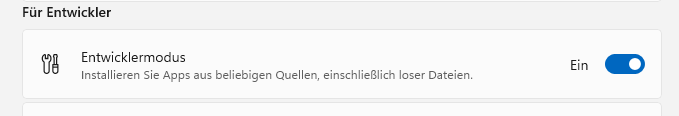
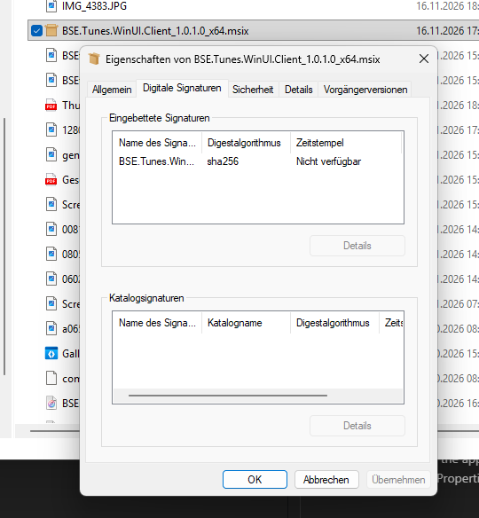
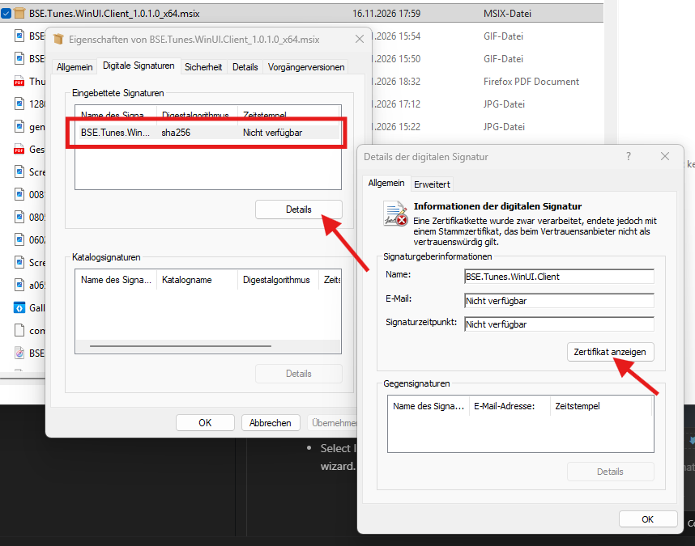
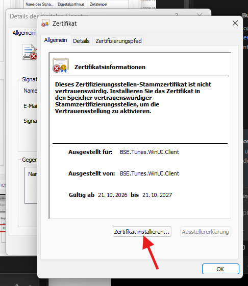
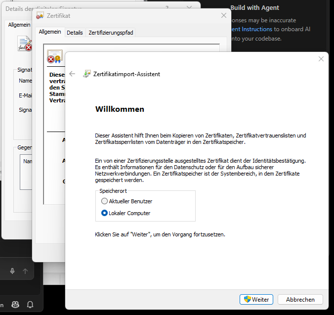
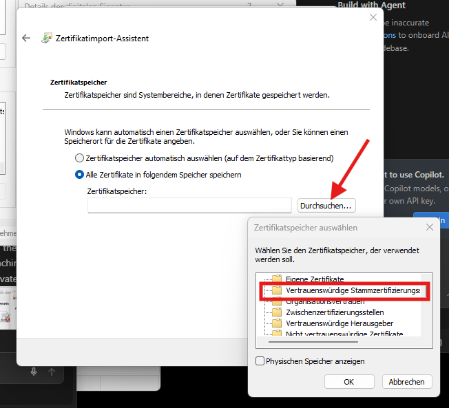

# Sideload line of business apps

## Step 1: Turn on sideloading

### Windows 11 setting

1. Open the Settings app
2. Go to System and select **Erweitert - Leistungsoptimierung und Entwicklerfeatures**
3. Turn on the **Entwicklermodus**

## Step 2: Import the security certificate

This step installs the app certificate to the local device. Installing the certificate creates the trust between the app and the device.

1. Download the app package
2. Open the Properties for the app package.

  - Go to the **Digital Signaturen** tab.
  - Select the certificate, and select **Details** to open the digital signature details window.
  - Select **Zertifikat anzeigen** to open the certificate window.
  
  - Select **Zertifikat installieren** to launch the certificate import wizard.
  

  3. On the **Zertifikatimport-Assistenten**, select Local Machine. This action might require an administrator to elevate.
  
  4. Continue the process to import the certificate into the Trusted Root Certification Authorities store.
  

 ## Step 3: Install the app

 After you enable sideloading and import the certificate, there are multiple methods you can use to install the app on devices.

 1. Manually open the .msix or .appx package in Windows Explorer.